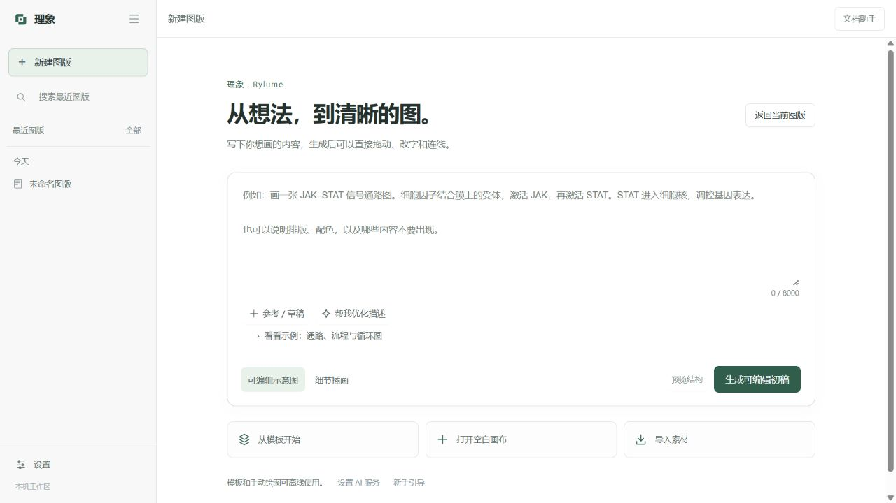
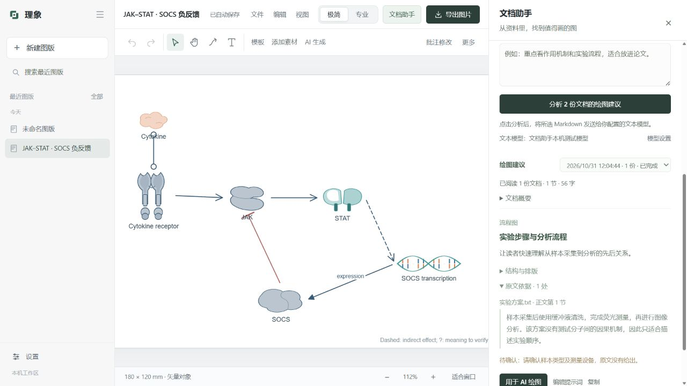
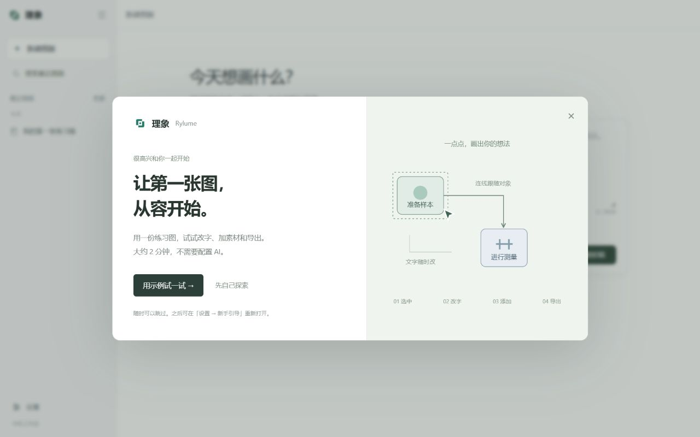
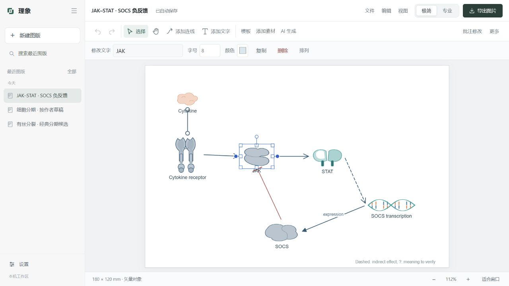

# 理象 · Rylume

本机科研图形工作台。把科研描述整理为对象、关系和区室，在矢量画布中直接编辑，再导出到论文或 PowerPoint。

## 导入已有科研图

首页选择「导入已有图」，或在绘图台点击「导入图」。支持 PNG、JPG、WebP、SVG 和 PDF（可选页码），单文件最大 10 MB。上传和转换只产生候选，不会覆盖当前图版；对照原图确认后，点击「打开为可编辑图版」才会创建新文档。

- 简单 SVG 可选择「本机拆分 SVG 元素」，不上传图片；文字与路径分别成为可选择的对象。路径型箭头不会自动推断为绑定连线，渐变、蒙版和复杂文字会明确转入 AI 拆解流程。
- 图片、PDF 和复杂 SVG 使用「AI 拆解文字、图形与连线」，将当前页发送给已配置的视觉模型；视觉模型留空时复用文本模型。识别出的文字可改、图形可移动，连线绑定对象端点。
- 复杂插画保留为独立图片块，可移动和缩放，但图片内部结构与像素文字不能直接编辑。候选会列出文字、矢量图形、绑定连线和图片块数量，转换成功不代表科学内容已经核实。
- 原文件始终保留在本机，支持取消、失败重试、中断恢复和重新对照。任何导入图版都可通过「文件 → 保存为模板 / 我的模板」保存为个人模板，再次使用会创建独立副本。

首页提供「AI 绘图 / 导入已有图 / 手动绘制」三个起点。编辑时工具固定在上方，选中对象后在右侧改字、调整字号和颜色；右侧收起后，点选对象会自动重新打开属性栏。



## 下载与启动

在 [Releases](https://github.com/zhao060206/Rylume/releases/latest) 下载最新版 **Rylume-X.Y.Z-Windows-x64.zip**，解压整个文件夹后双击 `Rylume.exe`。保留同目录下的 `_internal` 文件夹。需要 Windows 10/11 x64 和 Microsoft Edge WebView2 Runtime。

已有版本可在「设置 → 资源与更新」点击「检查更新」，发现新版后下载并保存图版，再点击「保存并重启更新」。GitHub 上的源码提交和学科资源包独立于 Windows 安装包；软件更新只使用正式发布的安装包。

也可以运行 `启动理象.cmd`。内置模板、素材和直接编辑可离线使用；AI 生成、批注修改和视觉审查需要在「设置 → 模型设置」中配置你自己的兼容服务。

## 4.5：更多科研素材与模糊查找

在「添加素材」中输入中文、英文、常用缩写或拼音别名即可查找。支持如“线粒题”“microsocpe”这样的近似词；多个词用空格分隔，例如 `线粒体 剖面`。准确结果排在前面，近似结果有明确标记；CD4、CD45、IL-6 等编号名称保持区分。学科、分类、收藏等筛选继续生效，「我的素材」使用相同的匹配规则。

本轮新增 1,052 个素材，第三方矢量库增至 1,688 个（另有 32 个原生图元）。新增矢量素材保留原始 SVG、作者、许可、固定版本来源和摘要；导出继续附带署名。素材扩充与本机对照验证方法见 [素材与搜索验收](docs/ASSETS-AND-SEARCH-4.5.md)。

## 4.4：自己的素材，与统一的工作台

从首页「导入素材」或绘图台「添加素材 → 上传素材」上传 PNG、JPG、WebP 图片，可按学科和自定义分类保存在「我的素材」。高保真矢量化使用原始像素生成贝塞尔路径，可选择调用自配模型分析轮廓和颜色、复核转换结果。原图与候选并排显示，点击「确认并加入素材库」后才能重复插入图版；转换失败、取消和重试都保留原始文件。素材图片原有文字会转曲，可另添独立文字。

首页、图版导航、顶部工具、属性、素材、模板、文档助手、批注、设置与导出统一使用简洁的视觉规范。选择对象不会挤动画布，素材确认操作固定在窗口底部，浮窗仍可移动、缩放和收起恢复。

每次升级在角落说明新增和改进，「设置 → 更新日志」可离线查看完整历史；构建要求当前版本具有非空变更记录。详见 [素材导入与 UI 验收](docs/UI-AND-ASSETS-4.4.md)。

## 学科资源与更新

发现新版本时，左下角常驻「点击更新」入口。悬停或键盘聚焦可查看目标版本的本次日志；点击开始下载，完成校验后再点击「重启更新」。日志预览支持移入鼠标滚动、Esc 收起；收起左栏后仍保留更新图标。没有新版本时不显示。

「设置 → 资源与更新」按需从 GitHub 安装化学、物理、材料、工程、地球环境、计算机与数学和医学资源。首批 134 个原创素材、28 个可编辑模板；生物库继续内置。图版保存素材快照，卸载包后仍可编辑和导出。

软件在角落提示正式新版，支持后台下载、校验以及保存后重启更新；启动失败自动恢复旧版。GitHub 直连不可用时可尝试备用线路，第三方线路的更新信息须通过发布者签名验证。4.1.1 及更早版本需先安装一次 4.2.0 才能使用备用线路。详见 [资源与更新说明](docs/RESOURCES-AND-UPDATES.md)。

## 4.0：从文档规划科研插图

右侧「文档助手」支持 PDF、PPTX、DOCX、文本及表格，本机转换为 Markdown 后，由自配文本模型推荐机理图、流程图、系统结构和其他合适图型。每条建议附原文位置、摘录、对象与布局、待确认项；提示词可编辑、复制或直接用于 AI 绘图，原来的创作描述可恢复。

支持多文档、转换预览、扫描 PDF 本机 OCR、取消与建议历史。旧版 PPT/DOC 需要本机 LibreOffice。提示词研究参考 PaperBanana 与 Paper2Any 的公开实现，采用原创中文提示词及本地引用核验。详见 [文档助手与提示词依据](docs/DOCUMENT-ASSISTANT-4.0.md)。



## 3.9：第一次打开，也知道从哪里开始

全新数据目录首次启动会出现可跳过的欢迎页。点击「用示例试一试」，即可在本机练习选中图形、修改文字、添加素材和导出；全程无需配置 AI。提示位于画布下方，每一步根据真实操作判断，文件导出取消或失败时不会误报完成。

练习图独立保存在左侧，可暂停、继续或随时退出。完成或跳过后不再自动弹出；首页与「设置 → 新手引导」可再次打开。已有图版的用户升级后保持原有工作区。



详见 [新手引导说明与验收](docs/ONBOARDING-3.9.md)。

## 3.8：左侧图版导航与顶部绘图工具

最近图版固定在左栏，支持搜索、日期分组和当前图版高亮；生成中、失败与取消的任务也保留入口。首页直接写下创作内容，参考图与手绘草稿按需展开，不再先选大卡片进入输入窗口。

绘图工具统一在上方：选择、平移、连线、文字、模板、素材和 AI。选中对象后在工具下方改字、字号、颜色、复制、删除和排列；素材与图层按需展开，不占用最近图版导航。切回新建会恢复尚未提交的文字、优化结果和参考设置。



详见 [新版工作区与验收](docs/WORKSPACE-3.8.md)。

## 3.7.1：手绘草稿智能整理与插画分层

上传手绘草稿默认使用「智能整理」：保留大致构图、阅读顺序与连接含义，自动整理同类尺寸、对齐与间距，并保留不同对象的科学状态。可以切换「严格保留位置与尺寸」；使用已有可编辑画布作为草稿时默认保持原位置。

细节插画按独立主体生成图片，文字、箭头及箭头文字始终单独保留，可移动、改字、调整含义与连接。手绘排版草稿提供给结构规划器，不再把歪斜的轮廓作为单个主体的描摹依据。空间不足或锁定对象阻碍整理时给出明确提示，不以缩小字号或添加机制掩盖问题。详见 [草稿排版与分层说明](docs/SKETCH-LAYOUT-3.7.1.md)。

## 3.7：重新整理创作入口

3.7 曾提供「用 AI 创建」「从模板开始」「自己动手画」三个起点；3.8 已整合为首页直接输入与小型辅助入口。AI 创作在独立的宽窗口中完成：写下内容、添加可选参考或手绘草稿、选择示意图或插画，再生成初稿。输入、参考和生成按钮可以同屏使用，关闭窗口后保留输入。

优化描述先与原文并排核对，采用后仍在输入区保留原文。继续改写原文时自动停用旧优化，也可随时手动停用。参考图支持拖入、放大预览、用途选择与更换；尺寸和分辨率按需展开。详见 [设计依据与验收](docs/CREATION-UX-3.7.md)。

## 3.6：统一生成与草稿绘图

生成面板可上传参考图、直接手绘草稿，或使用当前画布的对象与连线作为草稿。原图与结构约束保存在本机；可先查看结构与布局，再生成可编辑版本。矢量和插画共用对象画布，插画内部为像素，编辑粒度会在导出时说明。

原始科学内容与增强描述分别保存。简短有丝分裂主题提供带教科书来源的候选，各分期具有不同形态。局部重绘另存修改版；断连、取消和失败时保留已提交草稿。详见 [生成与草稿说明](docs/GENERATION-3.6.md)。

## 3.5：自由连接与文字定位

选中箭头，拖动两端圆点到对象边缘的任意位置；绿色轮廓和圆点显示吸附结果。端点会按边缘的相对位置保存，随对象移动、缩放和旋转。连接工具也可以从选中对象的边缘直接拖出新线。

对象名称和连线旁的文字可以单独拖动，双击仍可改字。点选文字后，用方向键微调，Shift 加大步长；独立文本也可直接拖动。每次拖动作为一步撤销，自动保存并同步至 SVG、PDF、PNG 和 PPTX。专业属性可精确设置端点所在边和沿边百分比，或将连线文字恢复为自动位置。

## 极简与专业工作台

右上角可在「极简 / 专业」之间切换。两种模式共用同一图版与全部功能，默认极简并记住上次选择。

极简模式保留常用绘图操作，精细设置、图层、检查和论文参考集中在「更多」；专业模式展开图层、对象属性与检查工具。统一了素材、属性、批注、导出与设置的视觉样式，模板直接打开模板库。

切换带有平滑布局过渡，保留图版修订、选区、缩放和视口中心。正在输入的文字会保存，批注草稿保留；尊重系统的减少动态效果设置。

详见 [双模式工作台说明](docs/WORKBENCH-3.4.md)。首次使用可点击首页「试着编辑示例图」，无需配置 AI。

## 主要功能

- 选择、拖动、框选、双击改字、复制粘贴、组合、对齐、图层与快捷键。
- 受体、分子、细胞、囊泡等分类素材；区分激活、抑制、结合、转换、转运和普通关联。
- 科研样例、构图模板、配色、180 mm 双栏和 90 mm 单栏排版。
- 框选或圈选多处批注，增强修改指令，预览 AI 候选及验证结果，确认应用后保留版本历史。
- 自动保存、本机草稿恢复、可编辑文件导入、图版重命名、分类、归档和历史版本恢复。
- SVG、PDF、300/600 DPI PNG、原生形状及文字可编辑的 PPTX；导出基于同一场景修订。
- 本地结构与排版检查、模型建议和作者确认分别显示。科研含义仍需要作者审阅。

素材包含原创图元和具有明确许可的第三方科学矢量插画；参考论文提供原文链接，论文图片不随软件分发。使用第三方素材时请保留导出文件附带的署名。

## 本机数据与密钥

任务、导出和模型配置默认保存在 `%LOCALAPPDATA%\CellFigureStudio`，沿用旧版目录便于升级。支持 `--data-dir`、`CELLFIGURE_DATA_DIR`；`--no-migrate` 可以禁止自动导入旧目录。

发行包和源码不包含开发者的 API key、模型配置、历史任务或日志。`config.example.json` 中的密钥为空。使用者输入的密钥仅用于自己配置的模型服务，并保存在自己的本机配置中；不要共享该配置文件。

## 从源码运行

已验证环境为 Python 3.13 x64、Windows 10/11。建议使用独立虚拟环境：

```powershell
python -m venv .venv
.\.venv\Scripts\Activate.ps1
python -m pip install -r requirements.txt
python -X utf8 app_server.py --port 8779 --no-migrate
```

浏览器调试：

```powershell
python -X utf8 app_server.py --no-window --port 8780 --data-dir out/debug --no-migrate
```

打开 `http://127.0.0.1:8780`。旧版插画工作区保留在 `/legacy`。可选的外部矢量模型不随安装包分发。

## 开发验证与构建

```powershell
python -m pip install -r requirements-dev.txt
python -m pytest -q
Get-ChildItem tests/test_*.mjs | ForEach-Object { node $_.FullName; if ($LASTEXITCODE) { throw 'Frontend check failed' } }
pwsh -NoProfile -File build_rylume.ps1
```

产物为 `dist-rylume/Rylume`，必须分发整个文件夹。原生窗口测试单独运行：

```powershell
python app_server.py --smoke-test --port 8786 --data-dir out/native-smoke --no-migrate
```

场景源文档、UI 与导出实现分别位于 `scene_document.py`、`ui/`、`scene_export.py`；批注流程位于 `annotation_service.py` 与 `annotation_planner.py`。

## 许可

项目代码使用 [AGPL-3.0-only](LICENSE)。第三方组件分别遵守其原始许可证，参见 [第三方说明](THIRD_PARTY_NOTICES.md)。发布页同时提供对应的 PyMuPDF/MuPDF 源码归档。

