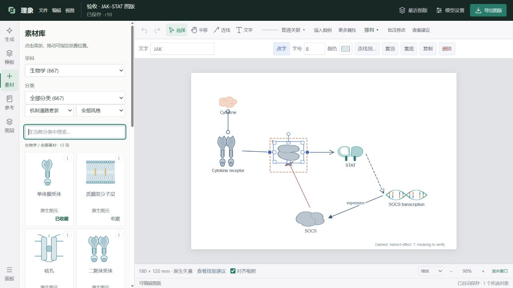

# 理象 · Rylume

本机科研图形工作台。把科研描述整理为对象、关系和区室，在矢量画布中直接编辑，再导出到论文或 PowerPoint。



## 下载与启动

在 [Releases](https://github.com/zhao060206/Rylume/releases/latest) 下载 **Rylume-3.1.0-Windows-x64.zip**，解压整个文件夹后双击 `Rylume.exe`。保留同目录下的 `_internal` 文件夹。需要 Windows 10/11 x64 和 Microsoft Edge WebView2 Runtime。

也可以运行 `启动理象.cmd`。内置模板、素材和直接编辑可离线使用；AI 生成、批注修改和视觉审查需要在「模型设置」中配置你自己的兼容服务。

## 学科资源与更新

顶部「资源与更新」按需从 GitHub 安装化学、物理、材料、工程、地球环境、计算机与数学和医学资源。首批 134 个原创素材、28 个可编辑模板；生物库继续内置。图版保存素材快照，卸载包后仍可编辑和导出。

软件会提示正式新版，支持后台下载、校验以及保存后重启更新；启动失败自动恢复旧版。3.0 及更早版本需手动安装一次 3.1。详见 [资源与更新说明](docs/RESOURCES-AND-UPDATES.md)。

## 主要功能

- 选择、拖动、框选、双击改字、复制粘贴、组合、对齐、图层与快捷键。
- 受体、分子、细胞、囊泡等分类素材；区分激活、抑制、结合、转换、转运和普通关联。
- 科研样例、构图模板、配色、180 mm 双栏和 90 mm 单栏排版。
- 框选或圈选多处批注，增强修改指令，预览 AI 候选及验证结果，确认应用后保留版本历史。
- 自动保存、本机草稿恢复、可编辑文件导入、图版重命名、分类、归档和历史版本恢复。
- SVG、PDF、300/600 DPI PNG、原生形状及文字可编辑的 PPTX；导出基于同一场景修订。
- 本地结构与排版检查、模型建议和作者确认分别显示。科研含义仍需要作者审阅。

素材包含原创图元和具有明确许可的第三方科学矢量插画；参考论文提供原文链接，论文图片不随软件分发。使用第三方素材时请保留导出文件附带的署名。

## 本机数据与密钥

任务、导出和模型配置默认保存在 `%LOCALAPPDATA%\CellFigureStudio`，沿用旧版目录便于升级。支持 `--data-dir`、`CELLFIGURE_DATA_DIR`；`--no-migrate` 可以禁止自动导入旧目录。

发行包和源码不包含开发者的 API key、模型配置、历史任务或日志。`config.example.json` 中的密钥为空。使用者输入的密钥仅用于自己配置的模型服务，并保存在自己的本机配置中；不要共享该配置文件。

## 从源码运行

已验证环境为 Python 3.13 x64、Windows 10/11。建议使用独立虚拟环境：

```powershell
python -m venv .venv
.\.venv\Scripts\Activate.ps1
python -m pip install -r requirements.txt
python -X utf8 app_server.py --port 8779 --no-migrate
```

浏览器调试：

```powershell
python -X utf8 app_server.py --no-window --port 8780 --data-dir out/debug --no-migrate
```

打开 `http://127.0.0.1:8780`。旧版插画工作区保留在 `/legacy`。可选的外部矢量模型不随安装包分发。

## 开发验证与构建

```powershell
python -m pip install -r requirements-dev.txt
python -m pytest -q
Get-ChildItem tests/test_*.mjs | ForEach-Object { node $_.FullName; if ($LASTEXITCODE) { throw 'Frontend check failed' } }
pwsh -NoProfile -File build_rylume.ps1
```

产物为 `dist-rylume/Rylume`，必须分发整个文件夹。原生窗口测试单独运行：

```powershell
python app_server.py --smoke-test --port 8786 --data-dir out/native-smoke --no-migrate
```

场景源文档、UI 与导出实现分别位于 `scene_document.py`、`ui/`、`scene_export.py`；批注流程位于 `annotation_service.py` 与 `annotation_planner.py`。

## 许可

项目代码使用 [AGPL-3.0-only](LICENSE)。第三方组件分别遵守其原始许可证，参见 [第三方说明](THIRD_PARTY_NOTICES.md)。发布页同时提供对应的 PyMuPDF/MuPDF 源码归档。
