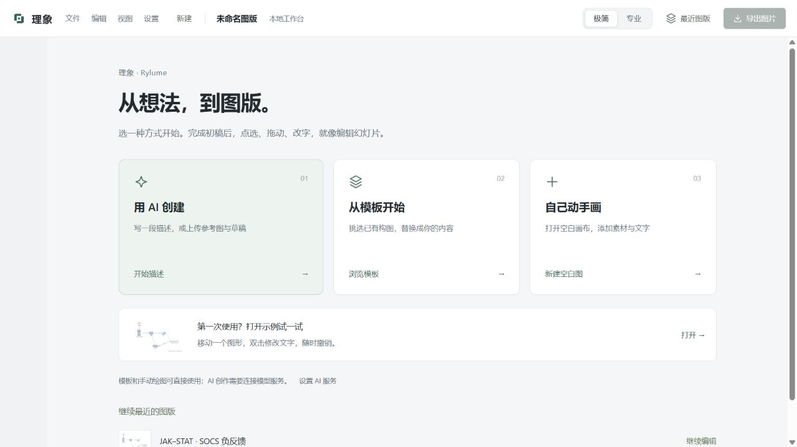
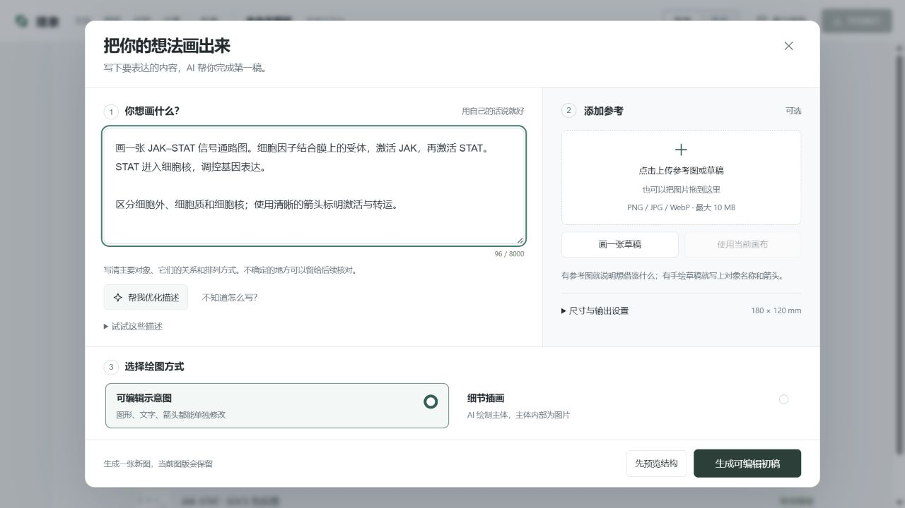

# Rylume 3.7 · 创作入口与 AI 输入交互

这一版优先处理「不知道从哪里开始」和「长描述挤在窄侧栏」两个实际问题。保留 SVG 编辑器、场景文档和既有生成保护逻辑，重新组织创作流程。

## 调研依据

2026-10-30 实际读取以下公开项目或官方文档。借鉴交互原则，未复制其代码或引入绘图框架。

| 来源 | 已核实的内容 | 在本项目中的应用 |
|---|---|---|
| [Excalidraw GitHub](https://github.com/excalidraw/excalidraw) | 图形库、绑定箭头与标签、撤销重做、本机自动保存 | 保持直接编辑和可恢复操作；将创作输入与编辑工具分开 |
| [tldraw GitHub](https://github.com/tldraw/tldraw) | 图形、工具、连接与 UI 可分别定制 | 重整前端创作入口，继续使用现有原生 SVG 编辑器 |
| [tldraw UI components](https://tldraw.dev/sdk-features/ui-components) | 功能按屏幕区域组织；属性随选中对象变化；组件可按需隐藏 | 空选区不显示空白编辑栏，极简模式收起重复底部操作 |
| [tldraw Chat starter kit](https://tldraw.dev/starter-kits/chat) | 通过独立绘图窗口提供图片、草稿、批注上下文，并保存可恢复快照 | 宽创作窗口统一文字、参考图和手绘入口，复用已有草稿恢复能力 |

同时使用本机 UI/UX Pro Max 的空状态、表单标签和提交反馈指引。其自动推荐中的营销页面结构和暗色配色不适合当前桌面绘图任务，未采用。Penpot 与 draw.io 部分帮助页面本轮无法访问，不作为交互实现证据。

## 使用流程

1. 首页选择「用 AI 创建」「从模板开始」或「自己动手画」。首次使用的示例是辅助入口。
2. AI 创作窗口先写科学内容，右侧可上传参考、拖入图片、手绘草稿或使用当前画布。参考图可预览、更换，并明确指定参考排版、草稿、画风还是对象。
3. 需要帮助时可查看示例或优化描述。示例需明确点击使用，会追加到已有内容；优化结果先与原文并排核对。
4. 采用优化后，主输入框继续显示作者原文，优化说明单独保存、可展开编辑或停用。手动改写原文会自动停用旧优化，避免用旧说明覆盖新意图。
5. 选择可编辑示意图或细节插画，可直接生成，也可先预览结构。尺寸与 DPI 按需展开。

关闭或按 Escape 收起创作窗口会保留本次输入，不会取消已提交的任务。重新打开后可继续查看进度；取消生成有独立按钮。主生成按钮支持 Ctrl+Enter。关闭窗口后返回的优化候选不会主动弹出，可重新打开后点击查看。成功载入结果后关闭创作窗口，失败仍显示状态并保留输入。

AI 插画主体内部仍为像素。选择说明明确区分可编辑图形与图片主体，未承诺逐像素结构可以分别拖动。

## 验收

- Python 回归：483 passed，7 subtests passed；普通测试不启动原生窗口。
- 全部 18 个 JavaScript 回归脚本通过；扩展已有真实控件回归，确认优化不替换作者输入、提交采用的候选、可随时停用优化。
- 1280 × 720 实机检查首页、AI 窗口、空输入提示、关闭重开、示例追加、方式切换、手绘窗口和示例图版编辑。主输入框和生成按钮同屏可见；展开内容在中部滚动，底部操作保留。
- 用隔离数据目录和本机确定性模型响应验证优化候选预览、采用和修改原文。这验证交互与数据提交，不代表真实模型生成质量验收。
- 最终 Windows 打包版原生窗口冒烟退出码为 0；七个前端文件逐字节匹配最终源码，保存、预览复用、草稿位置保留与四格式导出验证通过。
- 使用原生 dialog 提供键盘焦点约束和 Escape；动画尊重系统减少动态效果设置。

