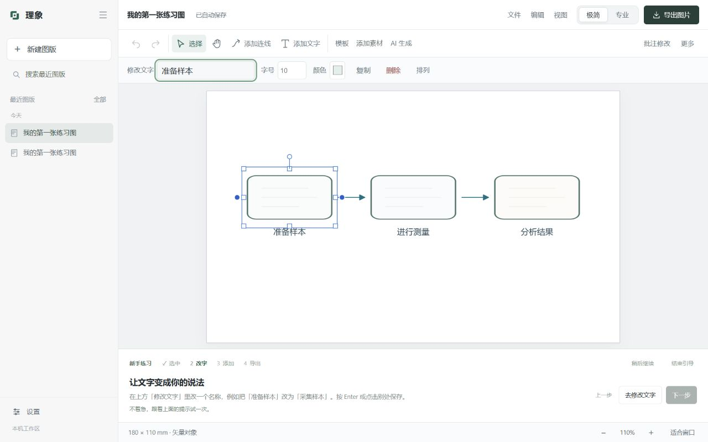

# Rylume 3.9 · 首次使用引导

新用户第一次打开时，可以用约两分钟的离线练习熟悉编辑。欢迎页提供「用示例试一试」与「先自己探索」，关闭或按 Escape 也可以退出。

## 实际练习

1. 打开独立的「我的第一张练习图」，点选任意步骤框。选框出现后可拖动，连线跟随对象。
2. 在顶部修改文字。只有非空的新名称才算完成；撤销后会重新提示练习。
3. 从顶部素材库加入一个素材，再拖到合适的位置。素材真正加入当前练习图后才允许继续。
4. 打开导出，根据用途选择 PNG、PPTX、PDF 或 SVG。只有返回有效文件路径才标记导出成功。关闭、取消或失败不算完成；也可以主动选择「稍后再导出」。

提示占用画布下方独立区域，不覆盖图形或工具。任何一步都可以「上一步」「稍后继续」或「结束引导」，练习图始终留在左侧。

## 完成之后

完成页可以回首页创作自己的图、设置 AI 服务或继续编辑练习图。模板与手动编辑无需模型配置。AI 服务由用户自行配置，不在首次欢迎时索要密钥。

首页「新手引导」和左下角「设置 → 新手引导」可重新打开。暂停后会重用已有练习图。切到其他图版时，提示返回练习图，不把其他文档的编辑或导出算作练习。

## 状态与保存

引导记录位于数据目录的 `onboarding.json`，与模型配置分开保存。默认数据目录仍为 `%LOCALAPPDATA%\CellFigureStudio`，随应用更新保留。读写线程安全，保存使用已有原子替换机制。关闭引导期间晚到的练习加载不会切走当前图版。

全新数据目录自动显示欢迎页；已有任务但没有引导记录的用户默认不弹出，仍可手动打开。完成或跳过后不再自动弹出。进度读取不可用时保持工作台可用。

## 验证

- Python：508 passed、7 subtests passed，1 项原生窗口交互按配置跳过；原生窗口冒烟独立执行。
- 前端：22 个脚本通过。新增练习证据与完整流程回归覆盖保存失败、文档隔离、暂停恢复、导出成功、取消期间晚到请求。
- 实机：首次自动欢迎、恢复同一练习、选中、把「准备样本」改为「采集样本」、加入囊泡、关闭导出后不完成、实际 PNG 保存后完成、从完成页返回创作入口和重新打开引导。
- 练习与 AI 配置均在独立 QA 数据目录中验证，不调用真实模型，也不载入个人密钥。

