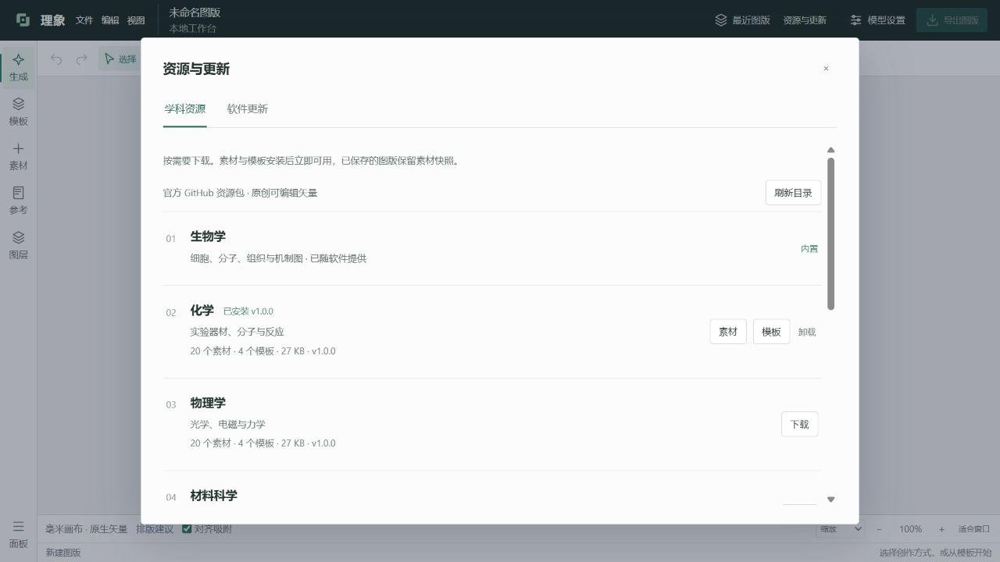

# 学科资源与软件更新

「设置 → 资源与更新」可下载化学、物理、材料、工程、地球环境、计算机与数学、医学资源包。也可以在素材库选择尚未安装的学科，直接打开相应下载行。



每包包含独立矢量素材、可编辑模板和单栏/双栏实际渲染预览。下载时显示进度并支持取消；SHA-256、包身份、SVG 与模板检查通过后才激活。更新资源包不需要重启。卸载前会提示，已经保存的图版包含所用素材快照，可以继续打开和导出。

软件在启动、恢复到前台和持续运行时检查是否到期，每 24 小时至多自动查询一次正式版本，有新版时在角落显示提示。也可手动检查。点击下载后先保留当前版本；下载完整并核验后，「保存并重启更新」会先保存当前图版。正在生成、批注或下载资源时须等待或取消任务。

Windows 打包版通过独立 PowerShell 辅助程序等待旧进程退出，在原安装目录旁保留备份，再启动新版。新版工作台完成加载并确认版本后更新完成；启动确认失败会恢复旧目录并启动旧版。更新记录位于本机数据目录的 `updates/apply/`。模型配置和图版数据位于程序目录以外，不参与替换。

GitHub 直连不可用时，软件会尝试内置的第三方备用线路。通过备用线路取得的更新清单必须通过内置的发布者公钥验签，安装包还要通过清单中的 SHA-256 校验；线路可能失效或缓存旧版本，软件不会安装比当前版本更旧的版本。4.1.1 及更早版本没有备用线路功能，需先手动安装 4.2.0。

源码模式提供版本提示和下载，不会替换 Python 解释器。不可写目录也可打开发布页手动安装。

## 维护资源包

```powershell
python tools/build_discipline_packs.py --output out/resource-packs
```

修改资源后提升包的语义版本，重新生成目录。将 ZIP 和 `catalog.json` 上传到官方仓库 `resource-packs-v1` Release，并设为 **非 latest**。内置的 `assets/resource-catalog.json` 供离线展示目录，在线「刷新目录」读取发布资源目录。不要覆盖已发布版本的 ZIP；新增版本后再更新目录。

资源包只允许 JSON、SVG、文本许可等数据，不包含执行脚本。原创资源与模板几何采用 CC0-1.0，原有第三方生物插画继续保留其各自许可。

## 发布软件新版

提升 `product_identity.py` 的版本，运行测试及 `build_rylume.ps1`，压缩完整的 `Rylume` 文件夹为 `Rylume-X.Y.Z-Windows-x64.zip`。

```powershell
python tools/prepare_update_manifest.py --archive dist-rylume/Rylume-X.Y.Z-Windows-x64.zip --output out/release --signing-key <私有签名密钥路径>
```

用 `vX.Y.Z` 正式 Release 发布安装包、生成的 `update.json`、`update.json.sig` 和 `SHA256SUMS.txt`，设置为最新正式版本。软件优先从公开发布附件读取更新目录；旧发行版没有目录时回退到 GitHub 公共 Releases API。两条途径均无需 token，更新包必须具有 SHA-256 校验值。

签名密钥必须离线备份并妥善保管，绝不能提交到仓库或放入安装包；丢失后已安装的软件无法验证新密钥签署的备用线路更新。

完整发布还应附带应用源码、对应开源依赖源码、许可证和素材署名。任何模型配置、API key、本机任务与日志都应排除。3.0 及更早版本需要手动安装一次 3.1，之后即可使用软件内更新。
