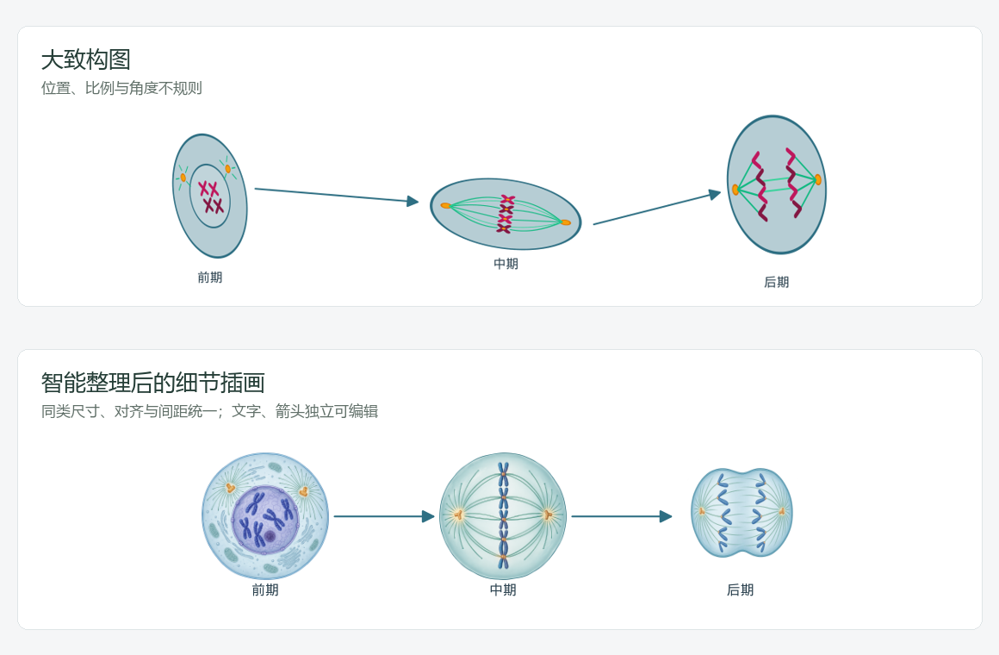

# 手绘草稿排版与细节插画分层

细节插画包含三类独立元素：主体图片、对象文字、关系箭头与箭头文字。主体内部像素不能直接当作独立矢量结构编辑；图外文字和箭头可以改字、移动、改关系、调整端点和控制点，并继续保存与导出。3.7.1 将这个区别直接写在创作方式选项中。

## 草稿处理

- 上传的参考图或手绘草稿默认「智能整理」。原图供结构规划器识别对象、阅读顺序和连接；确定性排版器修正位置抖动、同类尺寸、对齐、间距及旋转。横排、多行、环形分别处理，不统一套成一行。
- 科学类型、状态、实体 ID、标签及连接含义保持。不同分期和不同结构保留应有形态，不因为尺寸整理而画成同一个对象。
- 可以选择「严格保留位置与尺寸」。直接使用已经精细编辑过的画布时，默认使用严格保留；用户仍可切换智能整理。
- 锁定对象、独立文字、背景、膜结构和已有分组装配受保护；区室中的对象留在原区室内。空间不足或受锁定影响存在重叠时保留草稿并提示核对，不缩小到不可读字号，不增加科学关系。
- 智能整理中的排版参考/手绘草稿不再直接作为单主体图片编辑的描摹输入，避免把歪斜轮廓复制到插画。规划器仍读取原图；主体根据提取的类型、状态和可见形态说明绘制。需要保留具体图像形态时可使用「参考对象与排版」或「参考画风」。

`layout_policy` 在预览、生成、修订元数据和重试中保持一致。改变该选项会使旧结构预览失效。旧任务没有此字段时继续保持原有位置。

## 验证记录

2026-10-30：492 项 Python 测试、7 个子测试和全部 18 个前端脚本通过。新增案例覆盖手绘横排的对齐与等距、两行共用列、环形等角度、原始草稿不变、锁定与文字保护、过密画布提示、预览失效，以及两种输出方式下上传草稿默认整理与重试一致性。

另通过真实图像服务绘制三个独立细胞分期主体，返回三张图片，与三个独立标签、两条矢量箭头组装。随后在实际接口中改字、移动文字、修改箭头标签与控制点，确认三张图片的像素数据未改变；重新读取及 SVG、PDF、PNG、PPTX 导出通过，PPTX 的两个修改文字可单独编辑。测试配置仅在进程内读取，未复制到源码、任务或发行包。

下图的歪斜布局为程序构造的验证草稿，下半部分为实际服务生成的主体与确定性排版结果。这验证了布局和编辑分层；具体科学形态仍由作者核对。

