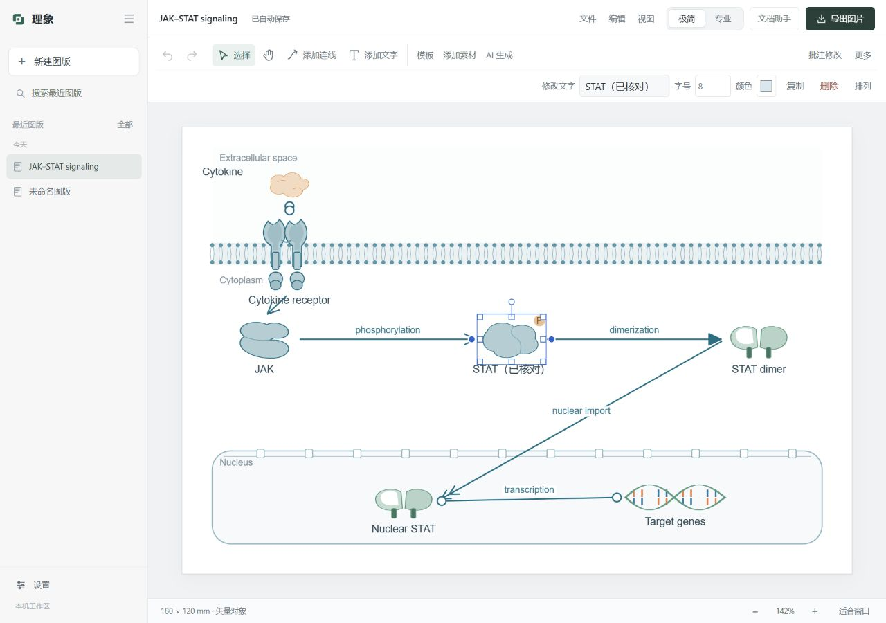
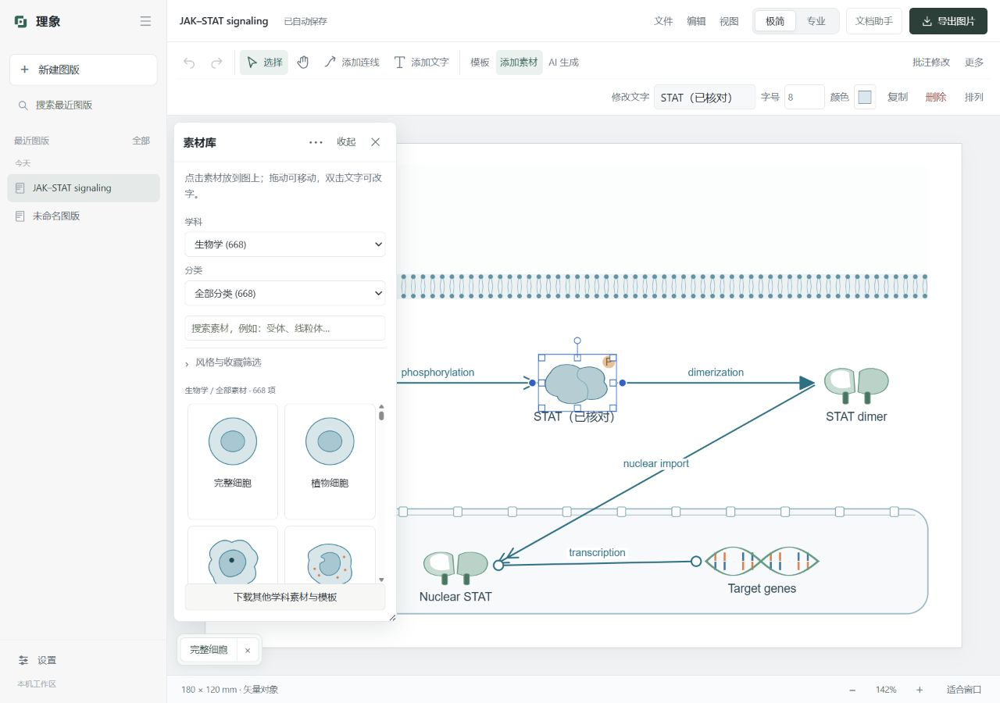

# 最近五次修改验收 · Rylume 4.3.0

2026-10-31。验收源码以 4.2.1 为基础，覆盖最近五个修改提交。测试使用独立数据目录与本机测试服务，未使用作者真实图版和模型凭据。

结论：关键自动化回归通过。原浮窗收起和窄屏快捷栏的可用性未达标，本次修复后重新验收。

| 修改 | 本轮核对 | 结论与边界 |
| --- | --- | --- |
| f9c89a6 连线吸附、连线定义、批注重绘 | 指针处理器覆盖中点/角点、旋转与缩放、Alt 自由边缘、撤销及重新绑定；真实 HTTP 候选应用/回退、调用授权与失败保留 | 自动化通过；模型调用为隔离替身，没有据此宣称实际生图质量合格 |
| 8696eb3 批注容量限制与重新核验 | 图片字节/像素预算、上下文精简、超容量降级、原科学问题保留、禁止重新生图及旧候选核验 | 自动化通过；无图像证据时保留作者确认要求 |
| 55093eb 素材浮窗与签名更新 | 篡改/缺失签名拒绝、旧版不降级、备用线路下载；素材库拖动、缩放、收起和恢复 | 更新回归通过；原收起只隐藏内容，仍遮挡图纸，已重做 |
| e23af5e 资源管理浮窗 | 保持窗口实例、后台状态和原入口恢复；多个收起项不互相覆盖 | 原入口无法正确恢复已收起窗口的情况已修复；自动化和实机复测通过 |
| 9c80032 右侧快捷编辑 | 选中/取消选中、改字、连线、取消、窄屏复制与撤销、极简/专业模式 | 原浮动快捷栏会盖住画面和检查器，已改为固定工具区；实机复测通过 |

## 本次发现和修复

1. “缩小”后仍保留原宽度、留在图上：改为底部带名称的恢复条，窗口本体完全收起。多个窗口分别恢复或关闭。
2. 搜索和布局恢复不明确：保持同一实例，恢复原位置、尺寸、搜索与筛选，不重新创建窗口。
3. 多个初始化器各自管理层级：改为共享层级；再次点击窗口或入口会置前。
4. 素材面板坐标混用了网格区域和工作区：修正坐标来源，移动和恢复都限制在工具栏以下、页脚以上。
5. 窗口难以拖回：标题可用方向键移动；窗口选项提供“紧凑窗口”“放大查看”“恢复默认位置和大小”。
6. 快捷编辑栏遮挡图纸/检查器：宽屏置于顶部右侧；工作区较窄时预留固定第二行，选中与取消选中不会增减工具区高度。
7. 连线/平移难以退出：在工具区显示“取消连线”或“回到选择”。
8. 键盘冲突：浮窗标题与恢复条的键盘事件不再微调画布对象；按钮保留原生空格激活。
9. 首页操作重复、提示偏淡：文档功能保留顶部单一入口；示例在输入区展开并显式采用；提高辅助文字对比度。

## 实机验收记录

- 1280×720 / 1280×900：选中、改字和取消连线前后，画布与图纸坐标保持一致，快捷编辑的下边缘位于画布上边缘以上。
- 一次测量：画布 `[214,148,1066,536]`，图纸 `[397.5,183,699,466]`，选中前后相同。
- 960×800：快捷编辑位于 `[581,107,948,141]`，画布起点 y=148，控件均留在窗口内；从“排列”复制并撤销成功。
- 1920×1000：顶部单行，工具栏下边缘与画布起点均为 y=104。
- 窗口从 `[230.40,90,800,470]` 拖至 `[390.40,185,800,470]`，缩到 `[390.40,185,564,354]`；收起后按空格恢复，位置和尺寸相同。
- 两个窗口同时收起，底部分别显示名称；原入口和底部名称均能恢复。素材搜索“线粒体”恢复后保留。
- 缩窄窗口后恢复详情，右边缘限制在 952，仍可见标题和关闭按钮。
- 窗口打开时仍可添加文字和编辑画布；收起资源管理窗口不退出后台任务。

## 自动化与验证范围

完整 Python 回归：569 passed、7 subtests passed、1 项原生窗口测试按设计跳过。原生打包启动另外验收。

前端回归：现有 27 组脚本通过，包含连线吸附、选择与快捷键、草稿恢复、批注和工作台模式；浮窗测试已从单纯边界公式扩展到真实控制器的收起/恢复、多窗口层级、关闭清理、重复初始化和小窗口恢复。

机器检查、隔离 HTTP 模型替身和手动实机检查分别提供证据。真实模型的科学准确性和美术质量需要另行固定样本评估，本轮没有调用付费模型，也没有把替身结果作为真实模型质量结论。第三方下载线路的长期可用性也不由本轮测试保证。
