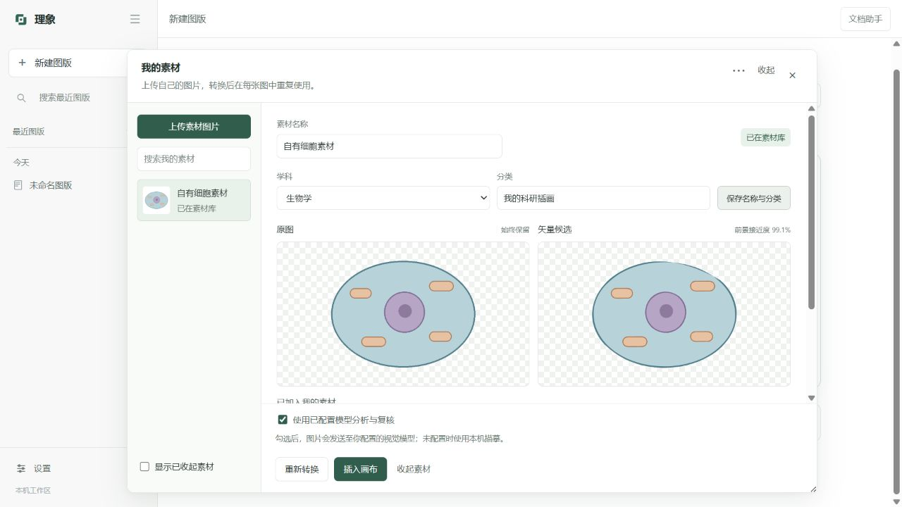
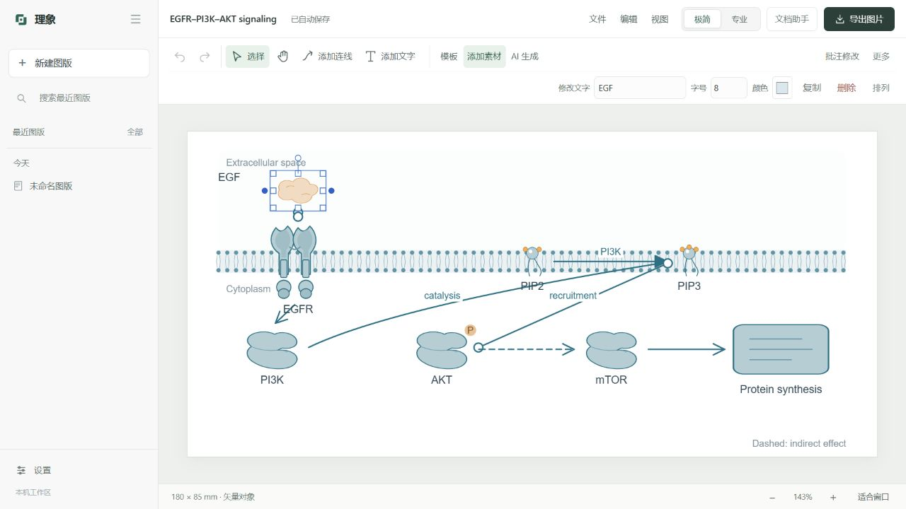

# 4.4 素材导入与界面验收

本次请求中的上传对象是“素材图片”。原有参考图和手绘草稿生成入口继续使用原来的流程。

## 使用路径

1. 首页「导入素材」，或画布「添加素材 → 我的素材 / 上传素材」。
2. 上传 PNG、JPG、WebP，最大 10 MB、3600 万像素；原始文件完整保留，工作副本最长边不超过 2000 px，保留透明通道。
3. 修改名称、学科和自定义分类。点击保存后生效。
4. 点击「高保真矢量化」。默认勾选使用已配置模型，可取消以完全在本机描摹。
5. 模型分析轮廓、颜色和适用性；VTracer 按原图生成贝塞尔路径；实际渲染后计算前景像素差异，再请求模型对照复核。
6. 并排查看原图和候选、差异与限制。点击「确认并加入素材库」后，才能插入图版重复使用。
7. 插入后支持移动、缩放、旋转、配色和独立标签；图版保存素材快照，收起素材后仍可重开、编辑和导出。

模型配置、图片和任务位于本机用户数据目录，不随安装包发布。勾选模型分析时，缩小后的图片发送到用户配置的服务。模型断连或不支持图片时，明确标记为本机转换，不能显示 AI 复核通过。

## 质量与可编辑性边界

输出是经过限定 SVG 子集验证的真实路径，不含嵌入位图、脚本或外部资源。单素材快照最多 256 KB、2500 节点，先尝试高精度，再降低调色精度；仍超限就提示裁剪，不用位图伪装矢量。PPTX 导出将路径转换为原生形状。

单个导入素材在画布中作为一个对象编辑，内部路径可在导出的 SVG / PPTX 中进一步处理。图片原有文字会转曲，不能自动保证重建为可编辑文字。复杂照片、纹理和渐变可能失真；前景 RGB 接近度只代表栅格对照，不能当作结构完整性或科学正确性的证明。原图一直保留，可重新转换，已保存图版中的快照不被后续候选替换。

## 界面设计约定

- 首页直接描述生成，下方提供模板、空白画布和素材导入三个起点；示例继续可从描述示例与新手引导进入。
- 左侧专用于图版和历史；工具位于顶部，属性与文档助手位于右侧。极简与专业模式共享颜色、字体、间距、控件和窗口规范。
- 暖中性背景、深灰正文、单一墨绿色强调。避免装饰渐变和大片高饱和背景；科学 SVG 的配色不受界面皮肤影响。
- 对象快捷编辑使用固定工具区，选中不改变纸张位置。专业属性栏去除重复内边距，保留更宽的表单空间。
- 素材管理使用左侧列表、右侧原图/候选对照；确认和取消固定在底部。窗口可移动、缩放、收起到恢复条。
- 模板、资源包、批注、检查、文档、设置、导出和错误反馈采用同一控件规范。按钮有可见焦点，保留键盘操作，尊重减少动态效果设置。
- 更新后用角落卡片说明本次变化，可关闭；完整历史离线保存。Rylume.spec 阻止没有当前版本变更记录的构建。

## 验收证据

- 全量 Python：573 passed、7 subtests passed，1 个原生窗口测试按默认设置跳过；单独完成打包版原生冒烟。
- 原有全部 JavaScript 行为测试通过。新增真实 HTTP 集成覆盖上传、原文件哈希、模型分析与复核、断连降级、候选确认、旧候选拒绝、取消、分类、收起恢复、图版快照及 SVG / PDF / PNG / PPTX 导出。
- 检查发现并修复一个并发问题：后台完成与紧接着重试之间可能把旧 GET 快照误判为中断。中断恢复现在只发生在打开数据仓库时，最终状态保存与活动任务清理在同一锁内完成。
- 实际配置模型验证使用自制透明底细胞素材，分析与复核均 completed，前景像素接近度 99.1%，输出 16,512 字节；该结果仅代表这个样本。
- 浏览器实测上传、转换、确认、插入、自动保存、重新载入、模式切换、1024 px 和 1280 px 布局、日志入口。确认按钮曾被长预览挤到滚动区底部，已固定操作区。

截图：

